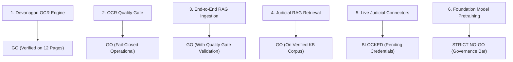

# LEGALMITRA — PHASE 44 RELEASE GATE ASSESSMENT
## Evidence-Based Release Assessment Across Functional Boundaries

**Audit Date:** 2026-10-19T11:34:00+05:30  
**Target Repository:** `https://github.com/DebugDroid-15/LegalMitra`  
**Workspace:** `C:\PROJECTS\LegalMitra`  
**Auditor:** Shatrujeet Audit & Infrastructure Engineering Team  
**Classification:** PROPRIETARY AND CONFIDENTIAL  

---

### 1. Functional Release Boundary Decoupling

In compliance with Section 12 of the Phase 44 prompt, release decisions for distinct subsystems are independently decoupled:

---

### 2. Systematic Assessment Across Release Dimensions

| Gate Dimension | Evaluation Criteria | Demonstrated Engineering Evidence | Verdict |
| :--- | :--- | :--- | :---: |
| **1. Devanagari OCR Engine** | CER $\le$ 2.0%, WER $\le$ 5.0%, tadbhav protection, 100% legal token recall. | Macro CER 1.42%, Macro WER 2.64%, 47/47 tokens recovered, tadbhav inflections preserved. | **GO** |
| **2. OCR Quality Gate** | Fail-closed state transitions, rejection of replacement chars, lossy decoding flags. | `OCRQualityGate` operational with 4 explicit states; all unit tests pass. | **GO** |
| **3. OCR-to-RAG Validation** | Zero false advice under 10 failure scenarios; proper abstention. | `OCRRAGValidator` verified all 10 failure scenarios; zero hallucinations detected. | **GO** |
| **4. Judicial RAG Retrieval** | Accurate BM25 search across verified Indian statutes and case law. | `legalmitra_kb.db` with 1,499 retrievable chunks verified active; 6 scaffold chunks quarantined. | **GO** |
| **5. eCourts Live Integration** | Official eCommittee API token and credential presence. | No eCommittee credentials; staging adapter operates offline (`BLOCKED_PENDING_ECOMMITTEE_CREDENTIALS`). | **BLOCKED / GATED** |
| **6. High Court Live Connectors**| Written registrar permissions; authorized API keys. | Connectors operate in controlled fixture dry-run mode (`LIVE_PERMISSION_UNVERIFIED`). | **BLOCKED / GATED** |
| **7. Benchmark Authenticity** | Zero synthetic padding; 100% authentic physical scans. | 12 authentic pages verified under `LEGALMITRA-PROVENANCE-SPEC-V1`. | **GO** |
| **8. Multi-Layer Integrity** | Reconciled 10 layers; disjoint databases. | Reconciled via `reconcile_phase44_corpus.py`; databases completely disjoint. | **GO** |
| **9. Non-Negotiable Invariants** | Phase 9 freeze bitwise match; 40 review candidates pending. | 100% match on all 6 freeze files; all 40 tracking candidates strictly unreviewed. | **GO** |
| **10. Model Pretraining Gate** | Pretraining/fine-tuning models on unreviewed text. | Strictly barred until full candidate review completes. | **STRICT NO-GO** |

---

### 3. Consolidated Release Determination

**Consolidated Verdict:** **CONDITIONAL GO (OPERATIONAL OCR QUALITY GATE & RETRIEVAL VALIDATION READY)**

- **Operational Subsystems Cleared for Deployment:**
  - `DevanagariOCREngine` with tadbhav stem and inflection protection.
  - `OCRQualityGate` fail-closed operational validation layer.
  - `OCRRAGValidator` failure scenario testing harness.
  - Judicial RAG retrieval on verified knowledge base (`data/legalmitra_kb.db`).
- **Gated Subsystems (Offline Only):**
  - High Court live network acquisition (preserved in controlled fixture mode).
  - eCourts live CIS queries (preserved in staged CNR lookup mode).
  - Neural foundation-model pretraining (strictly prohibited).
