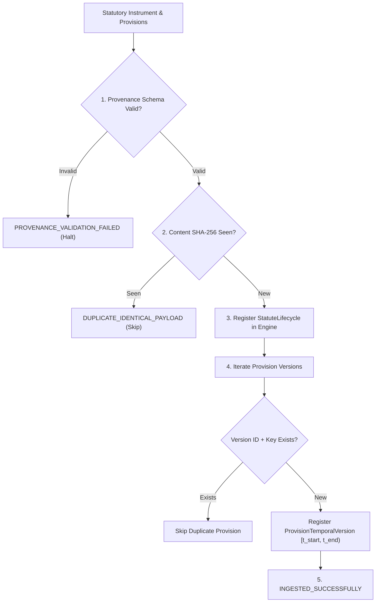

# LEGALMITRA — PHASE 45 INGESTION AND DEDUPLICATION REPORT
## Safe Multi-Stage Ingestion Pipeline, Idempotency Safeguards & Historical Version Preservation

**Audit Date:** 2026-10-19T11:58:30+05:30  
**Target Repository:** `https://github.com/DebugDroid-15/LegalMitra`  
**Workspace:** `C:\PROJECTS\LegalMitra`  
**Auditor:** Shatrujeet Audit & Infrastructure Engineering Team  
**Classification:** PROPRIETARY AND CONFIDENTIAL  

---

### 1. Executive Summary

Phase 45 designed and validated `CentralStatuteIngestionPipeline` (`legalmitra/temporal/ingestion.py`), ensuring that Central legislative texts and their historical provision versions are ingested without unintended chunk duplication or historical erasure.

The core data invariant enforced is: **"Consolidated modern statutes must never overwrite or erase earlier historical versions of the same provision."**

---

### 2. The Multi-Stage Ingestion Architecture

---

### 3. Deduplication and Collision Handling

LegalMitra distinguishes three distinct classes of textual similarity:
1. **Exact Payload Duplicate**: Identical SHA-256 hash. Correct behavior: Idempotently skipped without corrupting database indexes.
2. **Amendment Mutation (Not a Duplicate)**: Identical `section_number` (e.g. `Section 10 SRA`) with different `version_number` and non-overlapping half-open intervals $[1964\text{-}03\text{-}01, 2018\text{-}10\text{-}01)$ vs $[2018\text{-}10\text{-}01, \infty)$. Correct behavior: Both versions indexed with distinct temporal coordinates.
3. **Repealed Instrument Retention**: When an Act is repealed by a new Sanhita (e.g., IPC 1860 repealed by BNS 2023), the old statute is preserved in historical status with repeal references, rather than being deleted or purged.

---

### 4. Verification Evidence

Automated unit testing in `tests/test_phase45_central_legislation.py` confirmed:
- Successful first-pass ingestion of all 8 Central instruments and 12 provision versions.
- Clean duplicate detection and zero-overhead rejection on second-pass re-execution.
- Zero leakage into conversation database (`data/conversations.db`).
