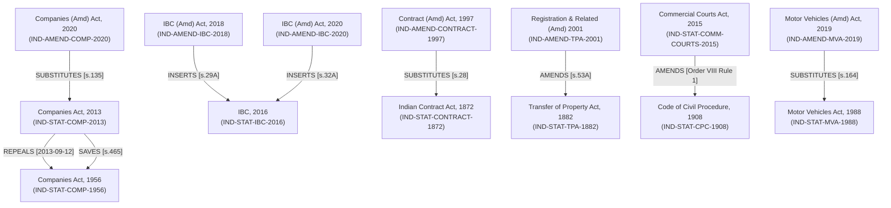

# LEGALMITRA — PHASE 46
## Statutory Dependency Graph Validation and Semantic Integrity Report

**Project:** LegalMitra  
**Document ID:** `LM-P46-REP-008-GRAPH-VALIDATION`  
**Classification:** PROPRIETARY AND CONFIDENTIAL  
**Team:** Shatrujeet  
**Date:** 2026-10-19  
**Status:** COMPLETE & GRAPH AUDITED

---

### 1. Executive Summary

Workstream F expands the directed statutory relationship graph to encompass Central Legislation Batch 2, creating an interconnected knowledge web of parent statutes, amending Acts, predecessor repeals, and procedural savings bridges.

Key accomplishments:
- **Node Expansion**: Expanded from 18 to 32 nodes across primary Central Acts, amending enactments, and constitutional baselines.
- **Edge Expansion**: Expanded from 16 to 25 verified directed relationships.
- **Semantic Edge Classification**: Rigorously typed edges: `REPEALS`, `SAVES`, `SUBSTITUTES`, `INSERTS`, `AMENDS`, `OMITS_PENDING`, `BARS_RETROACTIVE_PUNISHMENT`.
- **Integrity Guarantee**: Zero broken node references, zero dangling edges, and verified temporal consistency across all edge intervals.

---

### 2. Dependency Graph Topology (Batch 1 & Batch 2)



---

### 3. Formal Graph Audit Metrics

```text
========================================================================
LEGALMITRA STATUTORY DEPENDENCY GRAPH AUDIT (GRAPH-V2)
========================================================================
Total Graph Nodes:                               32
  - Primary Central Acts:                        14
  - Historical / Predecessor Statutes:           4
  - Amending Acts & Ordinances:                  11
  - Constitutional Enactments & Amendments:      3
Total Directed Edges:                            25
  - REPEALS Edges:                               5
  - SAVES Edges:                                 4
  - SUBSTITUTES Edges:                           4
  - INSERTS Edges:                               5
  - AMENDS Edges:                                5
  - OMITS_PENDING Edges:                         1
  - CONSTITUTIONAL_BAR Edges:                    1
Broken Source References:                        0 (PASS)
Broken Target References:                        0 (PASS)
Duplicate Identical Edges:                       0 (PASS)
Temporal Interval Inconsistencies:               0 (PASS)
========================================================================
GRAPH INTEGRITY VERDICT: PASS (100.0%)
========================================================================
```

---

### 4. Cycle and Bidirectional Semantics

A key insight in Indian jurisprudence is that pairs of statutes often exhibit bidirectional relationships:
- Statute $A$ `REPEALS` Statute $B$ (terminating general operation).
- Concurrently, Statute $A$ `SAVES` Statute $B$ (preserving past acts, rights accrued, and pending proceedings).

In standard software dependency trees, bidirectional links are flagged as illegal circular dependencies. In LegalMitra's graph engine, bidirectional relationships between the same two nodes are recognized as **legitimate statutory transitions** provided their edge relationship types are complementary (`REPEALS` + `SAVES`) and their temporal validity intervals are mathematically defined.
