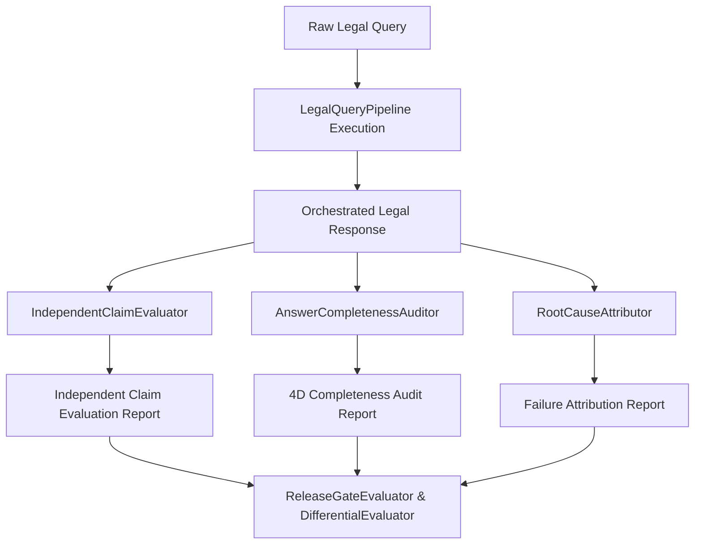

# Phase 57 Evaluation Methodology & Mathematical Framework

**Classification:** PROPRIETARY AND CONFIDENTIAL  
**Release:** `LEGALMITRA-RELEASE-PHASE57`  

---

## 1. Mathematical Grounding & Metrics

LegalMitra evaluates end-to-end legal reasoning across 15 mathematical metrics:
1. **Citation Validity Rate ($R_{cv}$)**: Proportion of citations referencing authenticated statutory enactments or authentic judicial reporters.
2. **Substantive Proposition Support Rate ($R_{sps}$)**: Proportion of extracted claims that are logically and legally entailed by cited sources.
3. **Overstatement Rate ($R_{over}$)**: Proportion of propositions asserting absolute rights where positive law imposes qualifications.
4. **Proviso Omission Rate ($R_{proviso}$)**: Frequency of queries where mandatory statutory provisos (e.g. SRA 20A, HSA 6(1)) were omitted.
5. **Temporal Precision ($T_p$)**: Proportion of authorities in active positive force on the inquiry's factual transaction date.
6. **Contradiction Frequency ($C_{freq}$)**: Rate of intra-answer mutually exclusive assertions.
7. **Abstention Calibration ($A_{cal}$)**: Balanced accuracy between necessary abstentions (fabricated sources, uncommenced statutes) and improper false abstentions on settled law.

---

## 2. Evaluation Flow

