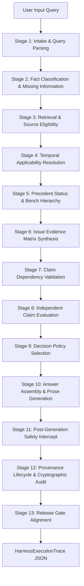

# LEGALMITRA PHASE 60 — FULL-PIPELINE ADVERSARIAL TEST HARNESS

**Project:** LegalMitra  
**Phase Identifier:** `LEGALMITRA-PHASE60`  
**Subsystem:** Evaluation & Quality Assurance  
**Module:** `legalmitra/evaluation/adversarial_harness.py`  
**Execution Date:** 2026-10-25  

---

## 1. Executive Summary & Design Architecture

Phase 60 established a reusable, deterministic end-to-end integration test harness (`PipelineExecutionHarness`) designed to exercise the complete query-to-answer pipeline across 13 distinct execution stages. Rather than testing pipeline components in isolation, the harness traces inputs from intake to final post-generation safety verification, capturing a machine-readable execution trace (`HarnessExecutionTrace`) for every scenario.

---

## 2. 13-Stage Deterministic Trace Schema

Every execution captures detailed machine-readable telemetry across the following stages:
1. `stage_1_intake`: Query parsing, candidate issues, legal domain classification, adversarial injection detection.
2. `stage_2_facts`: User-supplied facts, alleged facts, implicit assumptions, missing facts, clarification prompt.
3. `stage_3_retrieval`: Total retrieved chunks, statutory provisions, delegated rules, precedents, contrary authorities.
4. `stage_4_temporal`: Commencement status, uncommenced code detection, historical version matching.
5. `stage_5_precedent`: Bindingness determination, bench strength evaluation, proposition-level overruling detection.
6. `stage_6_matrix`: Multi-issue record synthesis, partial answer flags, alternative factual branches.
7. `stage_7_dependencies`: Prerequisite satisfaction and downstream claim blocking.
8. `stage_8_claim_validation`: Citation validity rate, substantive support rate, fabrication checks, overstatement checks.
9. `stage_9_decision_policy`: Policy state selection (`ANSWER_SUPPORTED`, `ANSWER_QUALIFIED`, `ANSWER_PARTIAL`, `ANSWER_CONDITIONAL`, `CLARIFICATION_REQUIRED`, `ABSTAIN_*`).
10. `stage_10_answer_assembly`: Assembled answer length, citations, governing provisions.
11. `stage_11_post_eval_safety`: Post-generation contradiction detection and intercept execution.
12. `stage_12_provenance_audit`: Provenance records count, SHA-256 audit digest check, scaffold isolation.
13. `stage_13_release_gate_status`: Alignment with fail-closed release gates.

---

## 3. Machine-Readable Artifact Manifests

The harness exports standardized JSON artifacts for persistent auditability:
- **Scenarios Manifest:** `data/22_central_legislation/phase60_adversarial_scenarios.json`
- **Execution Traces Manifest:** `data/22_central_legislation/phase60_execution_traces.json`
