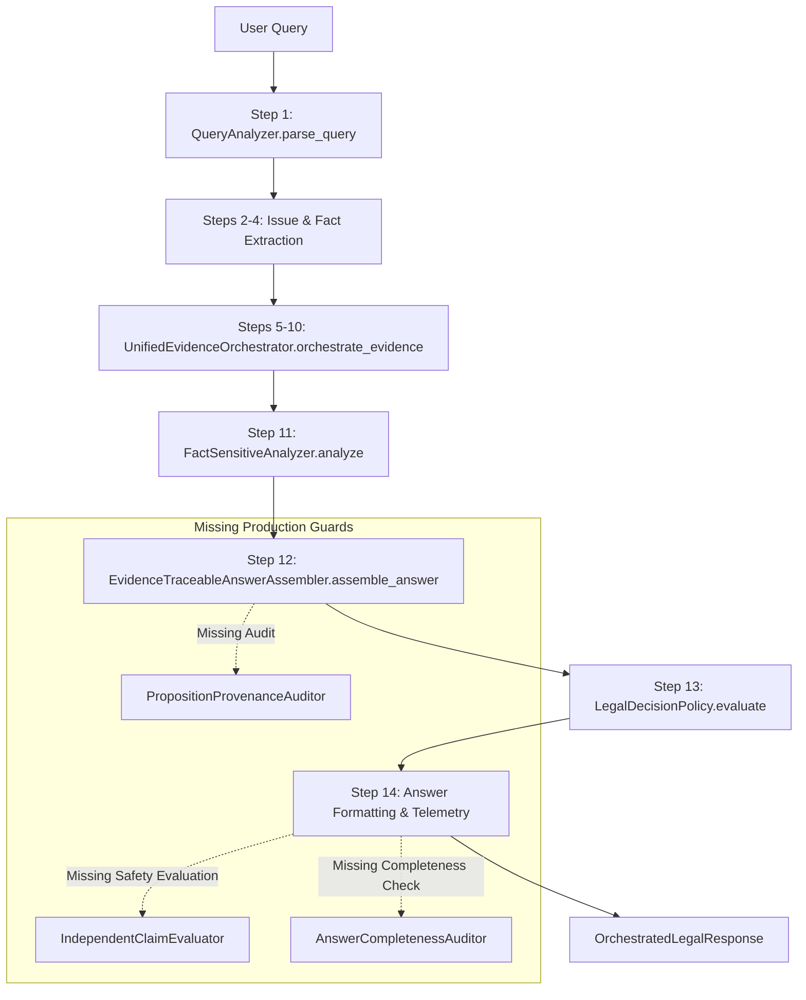

# LEGALMITRA PHASE 60 — INTEGRATION INVENTORY

**Project:** LegalMitra  
**Phase Identifier:** `LEGALMITRA-PHASE60`  
**Audit Date:** 2026-10-25  
**Scope:** Complete Query-to-Answer Pipeline Component Inventory & Invocation Traces

---

## 1. Subsystem Component Matrix

| Subsystem Component | Source Module | Primary Class / Method | Standalone Test Invocation | Runtime Production Path (`Pipeline.execute`) |
|:---|:---|:---|:---:|:---:|
| **Query Analysis** | `legalmitra/orchestration/query_analyzer.py` | `LegalQueryAnalyzer.parse_query` | Yes | **YES (Step 1)** |
| **Fact Analysis** | `legalmitra/orchestration/fact_analyzer.py` | `FactSensitiveAnalyzer.analyze` | Yes | **YES (Step 11)** |
| **Evidence Orchestrator** | `legalmitra/orchestration/evidence_orchestrator.py` | `UnifiedEvidenceOrchestrator.orchestrate_evidence` | Yes | **YES (Steps 5-10)** |
| **Temporal Law Engine** | `legalmitra/temporal/law_engine.py` | `TemporalLawEngine.query_provision_at_date` | Yes | **YES (via Orchestrator & Assembler)** |
| **Judicial Knowledge Graph** | `legalmitra/caselaw/knowledge_graph.py` | `LegalKnowledgeGraph.is_case_overruled` | Yes | **PARTIAL** (General overruled check, not proposition-level) |
| **Issue Evidence Matrix** | `legalmitra/orchestration/evidence_matrix.py` | `IssueEvidenceMatrix` | Yes | **YES (via AnswerAssembler)** |
| **Answer Assembler** | `legalmitra/orchestration/answer_assembler.py` | `EvidenceTraceableAnswerAssembler.assemble_answer` | Yes | **YES (Step 12)** |
| **Decision Policy** | `legalmitra/orchestration/decision_policy.py` | `LegalDecisionPolicy.evaluate` | Yes | **YES (Step 13)** |
| **Proposition Provenance** | `legalmitra/evaluation/provenance_model.py` | `LegalPropositionProvenance` | Yes | **YES (Instantiated on Claims)** |
| **Provenance Auditor** | `legalmitra/evaluation/provenance_model.py` | `PropositionProvenanceAuditor.audit_answer_propositions` | Yes | **NO (Standalone tests only)** |
| **Independent Claim Evaluator** | `legalmitra/evaluation/independent_evaluator.py` | `IndependentClaimEvaluator.evaluate_answer` | Yes | **NO (Evaluation / RG scripts only)** |
| **Completeness Auditor** | `legalmitra/evaluation/completeness_auditor.py` | `AnswerCompletenessAuditor.audit` | Yes | **NO (Release gates only)** |
| **Differential Evaluator** | `legalmitra/evaluation/differential_evaluator.py` | `DifferentialEvaluator.evaluate_differential` | Yes | **NO (Release gates only)** |
| **Release Gate Evaluator** | `legalmitra/evaluation/release_gates.py` | `ReleaseGateEvaluator.evaluate_all_gates` | Yes | **NO (Release validation only)** |

---

## 2. In-Depth Pipeline Execution Path Trace

The production legal pipeline implements a 14-step deterministic sequence in `LegalQueryPipeline.execute()`:

### Gap Analysis Findings:
1. **Unvalidated Provenance Objects**: While `AnswerAssembler` creates `LegalPropositionProvenance` objects with lifecycle states, it does not call `PropositionProvenanceAuditor.audit_answer_propositions()` to verify that claims satisfy monotonic lifecycle invariants.
2. **Missing Post-Generation Safety Gate**: The output of `LegalDecisionPolicy` and `assemble_answer` is not independently verified by `IndependentClaimEvaluator`. If generation introduces a subtle contradiction or overstatement, the pipeline emits it without an active interceptor.
3. **Precedent Retrieval Resolution**: `UnifiedEvidenceOrchestrator` does not evaluate `knowledge_graph.is_case_overruled(..., target_proposition=...)` during initial retrieval filtering, leaving proposition-specific filtering entirely to downstream stages.
