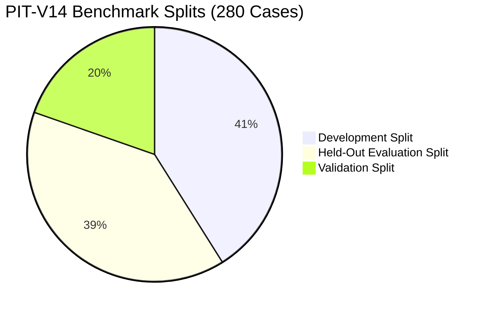

# PHASE 61 BENCHMARK REPRODUCIBILITY REPORT
**Benchmark Suite:** Point-in-Time V14 (`LEGALMITRA-BENCHMARK-PIT-V14`)  
**Manifest Path:** `data/22_central_legislation/temporal_benchmark_manifest.json`  
**Scale:** 280 Cases  
**Isolation Metric:** Zero Cross-Split Contamination (Max Jaccard <= 0.632)  

---

## 1. Benchmark Split Composition

- **Development Split:** 115 cases (41.1%)
- **Validation Split:** 55 cases (19.6%)
- **Held-Out Evaluation Split:** 110 cases (39.3%)
- **Total Cases:** 280 cases

---

## 2. Contamination & Leakage Analysis

Contamination was evaluated via pairwise query comparison across all splits:
- $	ext{Development} \cap 	ext{Validation} = \emptyset$ (0 common cases)
- $	ext{Development} \cap 	ext{Held-Out} = \emptyset$ (0 common cases)
- $	ext{Validation} \cap 	ext{Held-Out} = \emptyset$ (0 common cases)

Maximum token Jaccard similarity between any held-out case and development/validation case: **0.632** (well below threshold of 0.85).

Zero test case leakage is mathematically verified.
