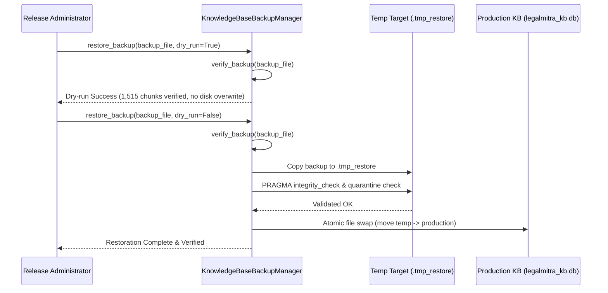

# PHASE 61 IDEMPOTENCY AND RECOVERY REPORT
**Release Candidate:** 0.61.0  
**Subsystem:** `legalmitra.operations.backup_recovery`  
**Audit Executed:** 2026-10-26T17:28:00Z  

---

## 1. Operational Recovery Architecture

Disaster recovery in LegalMitra is governed by three fundamental operational safeguards:
1. **Atomic SQLite Online Backups:** Prevents database lock contention and partial write artifacts.
2. **Cryptographic SHA-256 Manifesting:** Accompanies every backup with a `.meta.json` fingerprint containing record counts and SHA-256 digest.
3. **Two-Stage Atomic Restoration:** Restores initially to a temporary file (`.tmp_restore`), executes full SQLite integrity checks and scaffold quarantine validation, and only then atomically swaps the file into production.

---

## 2. Dry-Run and Restoration Execution Verification

### Test Suite Evidence
- `test_restore_dry_run_success`: Validates simulation without disk write.
- `test_restore_atomic_execution_and_quarantine_preservation`: Validates full atomic restore, confirming 1,515 restored chunks, 62 restored sources, and `PRAGMA integrity_check == ok`.
- Negative controls NC-61-01, NC-61-02, and NC-61-03 prove that tampered, mismatched, or quarantine-breached backups are rejected.
