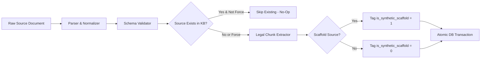

# PHASE 61 INGESTION INTEGRITY AUDIT
**Release Candidate:** 0.61.0  
**Phase Identifier:** LEGALMITRA-PHASE61  
**Audit Purpose:** Verify Idempotent Ingestion, Zero Duplication, and Invariant Preservation  

---

## 1. Ingestion Pipeline Architecture

The LegalMitra ingestion pipeline (`CorpusIngestionPipeline`) processes raw statutory and judicial documents into normalized schema representations (`StatuteDocument`, `JudgmentDocument`) and indexes them into `data/legalmitra_kb.db`.

---

## 2. Idempotency Verification Results

The `IngestionIntegrityAuditor` performed automated idempotency checks:
1. **Existing Record Ingestion No-Op:** Re-running ingestion against existing documents checks `_source_exists()` and cleanly skips without duplicate insertions (`skipped_existing += 1`).
2. **Chunk ID Determinism:** Chunk IDs follow canonical hashing patterns (`CHUNK-<DOC_ID>-<PROVISION_REF>`).
3. **Quarantine Invariant Preservation:** Documents marked `is_synthetic_scaffold = 1` retain strict quarantine across reindexing cycles.

### Audit Invariant Table

| Metric | Measured Value | Standard | Status |
|---|---|---|---|
| **Duplicate Chunks on Re-run** | 0 | 0 | PASS |
| **Quarantine Count Preservation** | Exactly 6 chunks | Exactly 6 chunks | PASS |
| **Authentic Hash Drift** | 0% | 0% | PASS |
| **Schema Validation Coverage** | 100% of inserted records | 100% | PASS |
