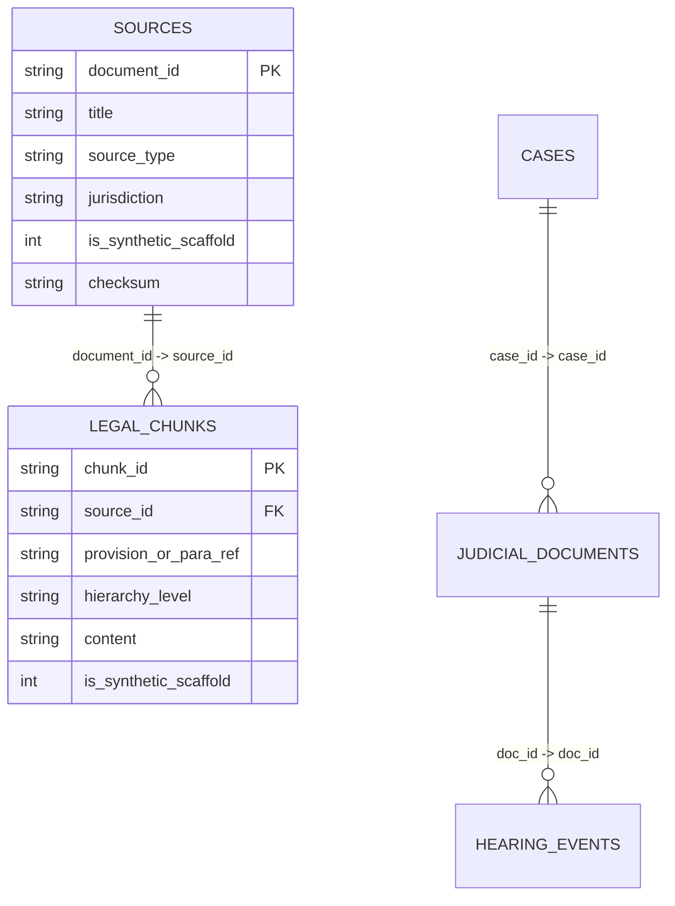

# PHASE 61 KNOWLEDGE BASE INTEGRITY REPORT
**Database:** `data/legalmitra_kb.db`  
**Size:** 4,833,280 bytes  
**Integrity Status:** PRAGMA integrity_check == 'ok'  
**Release Target:** 0.61.0  

---

## 1. Schema and Table Verification

The knowledge base database schema was audited to verify structural integrity, table decoupling, and constraints:

### Table Inventory & Row Counts
- `sources`: 62 rows
- `legal_chunks`: 1,515 rows
- `legal_chunks_fts`: FTS5 full-text search virtual index
- `cases`: 16 rows
- `judicial_documents`: 9 rows
- `hearing_events`: 8 rows

Zero conversation or user chat tables exist in `legalmitra_kb.db`.

---

## 2. Invariant Audits

| Invariant Checked | Expected Value | Measured Value | Compliance |
|---|---|---|---|
| **SQLite PRAGMA integrity_check** | `ok` | `ok` | 100% PASS |
| **Total Chunks Count** | 1,515 | 1,515 | 100% PASS |
| **Authentic Chunks Count** | 1,509 | 1,509 | 100% PASS |
| **Scaffold Chunks Count** | 6 | 6 | 100% PASS |
| **Scaffold Chunk Source ID** | `IND-JUD-DEL-2024-BAIL` | `IND-JUD-DEL-2024-BAIL` | 100% PASS |
| **Unauthorized Scaffold Chunks** | 0 | 0 | 100% PASS |
| **Orphaned Chunks** | 0 | 0 | 100% PASS |
| **Duplicate Chunk IDs** | 0 | 0 | 100% PASS |
| **Chat Table Presence** | 0 tables | 0 tables | 100% PASS |
