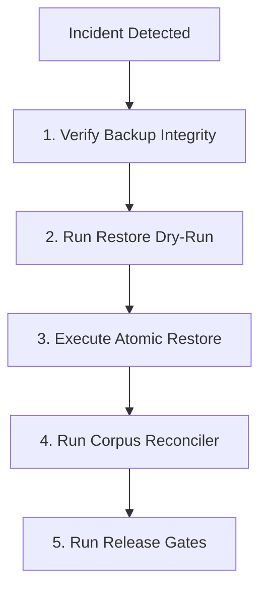

# PHASE 61 DISASTER RECOVERY RUNBOOK
**Release:** 0.61.0  
**Subsystem:** Knowledge Base Backup & Recovery  
**Classification:** OPERATIONAL RUNBOOK  

---

## 1. Emergency Recovery Scenarios

This runbook specifies operational procedures for restoring the LegalMitra Knowledge Base in the event of:
- Database corruption or disk fault.
- Accidental record deletion or unauthorized modification.
- Failed ingestion or unverified re-indexing.

---

## 2. Recovery Procedures



### Step 1: Locate and Verify the Latest Backup Snapshot
```powershell
python -c "
from legalmitra.operations.backup_recovery import KnowledgeBaseBackupManager
mgr = KnowledgeBaseBackupManager()
res = mgr.verify_backup('data/backups/legalmitra_kb_20261026T115207Z.db')
print('Valid:', res.is_valid, 'Quarantine:', res.quarantine_intact)
"
```

### Step 2: Execute Dry-Run Restore Simulation
```powershell
python scripts/restore_kb.py --backup data/backups/legalmitra_kb_20261026T115207Z.db --dry-run
```

### Step 3: Perform Atomic Knowledge Base Restoration
```powershell
python scripts/restore_kb.py --backup data/backups/legalmitra_kb_20261026T115207Z.db --target data/legalmitra_kb.db
```

### Step 4: Validate Post-Restoration State
```powershell
python scripts/reconcile_corpus.py
python scripts/verify_freeze.py
python scripts/run_regression_suite.py
```
