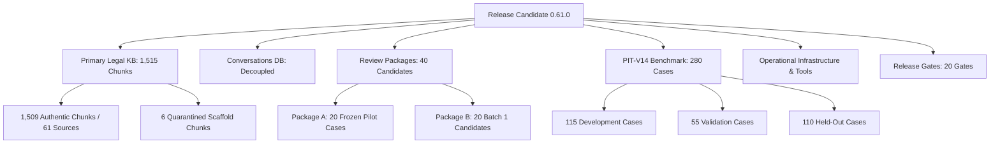

# PHASE 61 RELEASE CANDIDATE INVENTORY
**Release Identifier:** LEGALMITRA-RELEASE-PHASE61  
**Target Release Version:** 0.61.0  
**Phase Identifier:** LEGALMITRA-PHASE61  
**Generated UTC:** 2026-10-26T17:20:00Z  

---

## 1. Inventory Summary

This inventory documents all executable components, primary legal databases, evaluation benchmarks, review candidate registers, and operational runbooks comprising Release Candidate 0.61.0.

---

## 2. Component Inventory Table

| Component Identifier | Category | File Path / Location | Size / Scale | Provenance Status |
|---|---|---|---|---|
| **KB Database** | Primary Legal Corpus | `data/legalmitra_kb.db` | 1,515 Chunks / 62 Sources | Verified Authentic + 6 Scaffold |
| **Conversations DB** | User Interactions | `data/conversations.db` | 5 Conversations / 10 Messages | Physically Decoupled |
| **Review Register** | Legal Governance | `data/07_batches/review/review_tracking_register.json` | 40 Candidate Records | 100% Pending Human Review |
| **Review Snapshot** | Frozen Manifest | `data/06_review/PHASE9_REVIEW_SNAPSHOT_MANIFEST.json` | 6 Frozen Snapshot Files | Bitwise Identical (SHA-256) |
| **PIT-V14 Manifest** | Evaluation Benchmark | `data/22_central_legislation/temporal_benchmark_manifest.json` | 280 Cases (3 Splits) | Zero Contamination (Jaccard <= 0.632) |
| **Release Gate Subsystem** | Release Engineering | `legalmitra/evaluation/release_gates.py` | 20 Release Quality Gates | Evaluated Phase 61 |
| **Adversarial Harness** | Safety Evaluation | `legalmitra/evaluation/adversarial_harness.py` | 12 Compound Scenarios | 100% Safety Compliance |
| **Backup & Recovery** | Operations | `legalmitra/operations/backup_recovery.py` | Full snapshot + restore | Cryptographically Audited |
| **Corpus Reconciler** | Operations | `legalmitra/operations/reconciler.py` | Full KB & split audit | Automated Validation Engine |
| **Operational Traces** | Observability | `data/22_central_legislation/phase61_operational_traces.json` | 12 Traces / 13 Stages | Sanitization Clean |

---

## 3. Storage and File Hash Checksums

| Asset | File Name | Size (Bytes) | SHA-256 Fingerprint |
|---|---|---|---|
| Frozen Pilot Examples | `pilot_20_examples.jsonl` | 44,542 | `e01b22f50f36c3927b595ecd03e2258c6889f299e6394644b2cd4cb359ffa953` |
| Frozen Pilot Manifest | `pilot_20_manifest.json` | 21,705 | `9da3801fdc79514987dcd91ffacc81372ab5412a93002ddfd3d9c1c7050369a4` |
| Frozen Review Sheet | `pilot_20_review_sheet.csv` | 35,396 | `6f519165d45bac465e2c25de20369b74d136543307a49ecb84559f68a7dadcab` |
| Frozen Source Bundle | `pilot_20_source_bundle.json` | 62,870 | `3cf555e96743ece27b0e22d954d6535cea8a51cc9242c471416b9f46fb031f10` |
| Frozen Open Issues | `pilot_20_open_issues.md` | 7,903 | `0b82c4f6df0d9b6c755c6bf15ffb582c07cc6788a28d8ff610de4b645251f45e` |
| Phase 8 Open Issues | `PHASE8_OPEN_LEGAL_ISSUES_REGISTER.md` | 15,514 | `e5966e245c15f6cb96e48d57ede8e81be8a89ebe3aa843098afc961e86c2c508` |
| Phase 61 KB Snapshot | `legalmitra_kb_20261026T115207Z.db` | 4,833,280 | `dd21ac7a34d5c11b1e472e89bb8a25ad0414930552376a3cc54afbfb7a3a9d36` |
