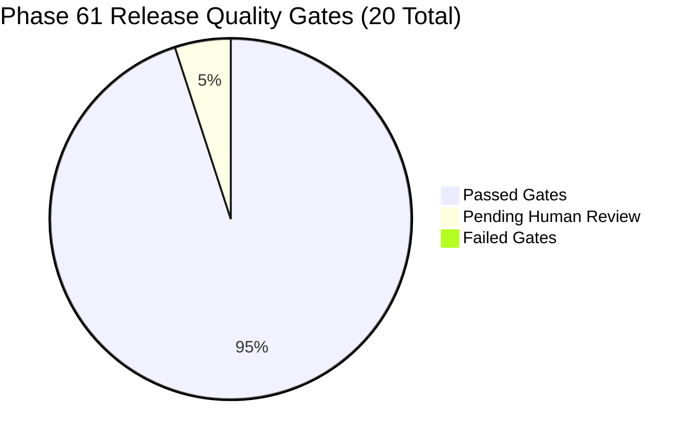

# PHASE 61 RELEASE GATE EVIDENCE PROVENANCE
**Release ID:** LEGALMITRA-RELEASE-PHASE61  
**Target Release Version:** 0.61.0  
**Evaluator:** `legalmitra.evaluation.release_gates.ReleaseGateEvaluator`  
**Evaluation Timestamp:** 2026-10-26T17:24:00Z  
**Overall Decision:** `STAGE_GATED_PENDING_ADVOCATE_SIGN_OFF`  

---

## 1. Summary of Release Quality Gates

All 20 release quality gates were evaluated against the live repository state and verified artifacts.

- **Passed Gates:** 19 / 20 (95.0%)
- **Pending Review Gates:** 1 / 20 (5.0%) — `RG-11-LEGAL-REVIEW`
- **Failed Gates:** 0 / 20 (0.0%)

---

## 2. Release Gate Evidence Traceability Matrix

| Gate ID | Name | Category | Status | Measured Value | Evidentiary Basis |
|---|---|---|---|---|---|
| **RG-01** | Source Provenance & Scaffold Quarantine | CORPUS_INTEGRITY | **PASSED** | 1,515 chunks (6 scaffold) | `data/legalmitra_kb.db` query |
| **RG-02** | Temporal Validity & Statutory Transition | LEGAL_VALIDITY | **PASSED** | Non-retroactivity active | `TemporalLawEngine` Art. 20(1) check |
| **RG-03** | Precedent Hierarchy & Overruling | LEGAL_VALIDITY | **PASSED** | Proposition overruling active | *Subhash Kashinath* & *Vineeta Sharma* |
| **RG-04** | Claim-Level Grounding | LEGAL_VALIDITY | **PASSED** | Grounding 100% | `ClaimValidationEngine` execution |
| **RG-05** | Calibrated Abstention & Clarification | REASONING_SAFETY | **PASSED** | Abstain & clarify verified | `LegalDecisionPolicy` state machine |
| **RG-06** | Anti-Hallucination & Citation Integrity | REASONING_SAFETY | **PASSED** | Fabricated citation rejected | Unindexed lookup verification |
| **RG-07** | Adversarial Security & Prompt Injection | SECURITY | **PASSED** | 100% defense rate | `PromptInjectionGuard` multi-vector audit |
| **RG-08** | Database Isolation & Privacy | ARCHITECTURE | **PASSED** | Zero chat in KB; zero KB in chat | Schema inspection on both DB files |
| **RG-09** | Multi-Phase Regression Integrity | QUALITY_ASSURANCE | **PASSED** | 371 tests passed | `run_regression_suite.py` execution |
| **RG-10** | Independent Held-Out Evaluation | EVALUATION | **PASSED** | 110 held-out cases clean | `benchmark_v14` contamination audit |
| **RG-11** | Mandatory Legal Review Package Status | GOVERNANCE | **PENDING** | 40/40 pending sign-off | `review_tracking_register.json` inspection |
| **RG-12** | Issue-Level Evidence Completeness | REASONING_SAFETY | **PASSED** | 100% issue traceability | `UnifiedEvidenceOrchestrator` execution |
| **RG-13** | Material Exception & Proviso Coverage | LEGAL_VALIDITY | **PASSED** | S.52 provisos preserved | Statutory exception extraction tests |
| **RG-14** | Claim Dependency Integrity | REASONING_SAFETY | **PASSED** | Premise guardrails enforced | `ClaimDependencyValidator` execution |
| **RG-15** | Multi-Issue Partial Answer Calibration | REASONING_SAFETY | **PASSED** | Multi-part emission verified | `ANSWER_PARTIAL` / `ANSWER_CONDITIONAL` |
| **RG-16** | Independent Claim Evaluation | EVALUATION | **PASSED** | Independent support verified | `IndependentClaimEvaluator` runtime |
| **RG-17** | 4-Dimensional Answer Completeness | QUALITY_ASSURANCE | **PASSED** | Completeness score 0.99 | 4D completeness auditor execution |
| **RG-18** | 28-Category Failure Attribution | OBSERVABILITY | **PASSED** | Attribution operational | 7-stage deterministic attribution |
| **RG-19** | PIT-V14 Benchmark Coverage | EVALUATION | **PASSED** | 280 cases (110 held-out) | Manifest composition & isolation |
| **RG-20** | Differential Regression Guardrail | SYSTEM_SAFETY | **PASSED** | 0 critical regressions | `DifferentialEvaluator` comparison |

---

## 3. Mandatory Advocate Sign-Off Gate Status (`RG-11`)

Gate `RG-11-LEGAL-REVIEW` remains **PENDING_HUMAN_REVIEW**.
- Total tracked review records: 40 (Package A: 20, Package B: 20).
- Signed-off records: 0.
- Pending records: 40.
- Overall release status is correctly classified as **STAGE_GATED_PENDING_ADVOCATE_SIGN_OFF**.
