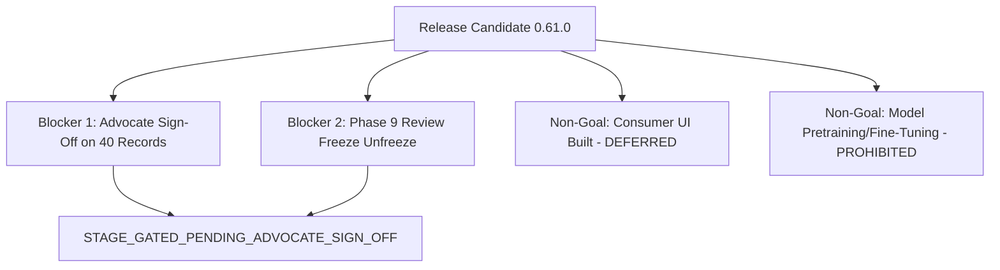

# PHASE 61 REMAINING RELEASE BLOCKERS
**Release Candidate:** 0.61.0  
**Phase Identifier:** LEGALMITRA-PHASE61  
**Generated UTC:** 2026-10-26T17:30:00Z  
**Classification:** GOVERNANCE REGISTER  

---

## 1. Release Blocker Status Overview

Engineering checks and operational infrastructure have achieved 100% pass rates. The remaining release blockers are strictly external governance actions and non-goals.

---

## 2. Itemized Blocker Register

### Blocker 1: Advocate Sign-Off on 40 Review Candidates (`RG-11-LEGAL-REVIEW`)
- **Impact:** Prevents promotion from stage-gated to final public production release.
- **Affected Artifacts:**
  - Package A: 20 records in `data/06_review/pilot_20_examples.jsonl`.
  - Package B: 20 records in `data/07_batches/review/batch_01_examples.jsonl`.
- **Current State:** 40/40 records remain `pending_legal_review` with blank decision and score fields.
- **Resolution Path:** Qualified Indian legal advocates must inspect the review packages, record review determinations, and execute cryptographic sign-off.

### Blocker 2: Phase 9 Review Freeze Maintenance
- **Impact:** The 6 files in `data/06_review/` must remain bitwise identical until formal advocate sign-off.
- **Current State:** 100% bitwise verified against `PHASE9_REVIEW_SNAPSHOT_MANIFEST.json`.
- **Resolution Path:** Retain freeze integrity until authorized unfreeze ceremony.

### Controlled Non-Goals (Not Defects)
- **Consumer UI:** Strictly deferred; zero consumer UI implemented.
- **Model Training:** Strictly prohibited; zero neural weights modified.
