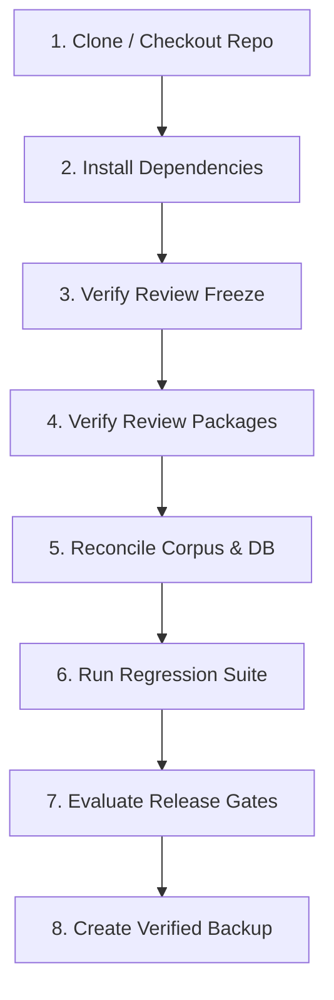

# PHASE 61 SETUP AND VERIFICATION RUNBOOK
**Release:** 0.61.0  
**Target Audience:** Release Engineers, Corpus Administrators, QA Auditors  

---

## 1. Environment Pre-Requisites

- Python 3.10+ (Verified on Python 3.11.0)
- SQLite 3.35+ (with FTS5 enabled)
- Git 2.30+
- PowerShell 7+ or standard Windows cmd / bash

---

## 2. Step-by-Step Setup and Verification Sequence



### Step 1: Environment & Dependency Validation
```powershell
python --version
pip install -e .
```

### Step 2: Verify Phase 9 Review Freeze
```powershell
python scripts/verify_freeze.py
# Must exit with code 0 and report 6/6 files verified
```

### Step 3: Verify Review Tracking Register
```powershell
python scripts/verify_review_packages.py
# Must exit with code 0 and report 40/40 records pending_legal_review
```

### Step 4: Reconcile Knowledge Base & Corpus
```powershell
python scripts/reconcile_corpus.py
# Must report: Sources: 62, Chunks: 1515, Scaffold: 6, Status: PASSED
```

### Step 5: Execute Complete Multi-Phase Regression Suite
```powershell
python scripts/run_regression_suite.py
# Must pass all 371 tests across 22 test files
```

### Step 6: Generate Release Gates Evaluation
```powershell
python -c "from legalmitra.evaluation.release_gates import ReleaseGateEvaluator; e = ReleaseGateEvaluator(); s = e.evaluate_all_gates(); print(s.release_id, s.overall_decision)"
# Must output: LEGALMITRA-RELEASE-PHASE61 STAGE_GATED_PENDING_ADVOCATE_SIGN_OFF
```

### Step 7: Create Production Backup Snapshot
```powershell
python scripts/backup_kb.py --notes "Production Release Candidate 0.61.0 Snapshot"
```
